<div align="center">

# OpenTerminal

**A terminal‑style market workspace built entirely on free, public market data.**

Dark. Dense. Keyboard‑driven. Zero paid API keys, zero subscriptions.

[](#-tech-stack)
[](#license)
[](#%EF%B8%8F-data-sources)
[](#-contributing)

<br/>

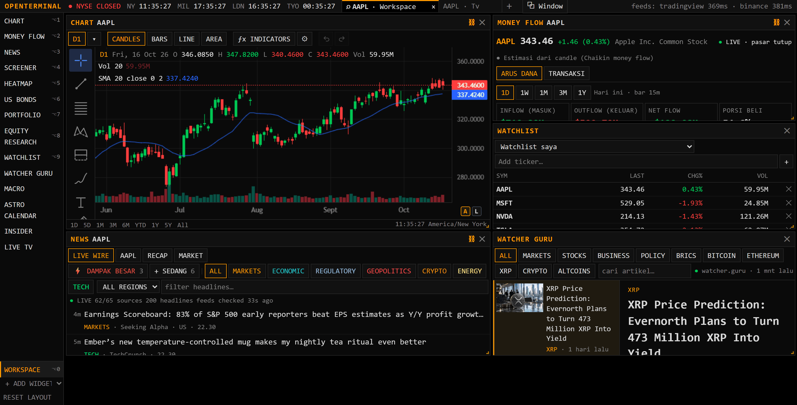

<sub>A fork of <a href="https://github.com/ErTasselli/OpenTerminal">ErTasselli/OpenTerminal</a>, grown into a full terminal: live TV and a Fed watcher, a macro engine, quant forecasts, an insider feed, money flow and more. ⭐ Star it if it's useful to you.</sub>

</div>

<br/>

## Why OpenTerminal?

Real trading terminals cost **$2,000+ a month**. Most retail dashboards either lock the good stuff behind a paywall or run on a single flaky data source that breaks the moment you need it.

OpenTerminal stitches together **free, public market‑data endpoints** (the same ones that power major finance sites' own front ends) into one fast, keyboard‑first workspace that runs entirely on your machine. Every endpoint has a fallback chain, so one provider's hiccup never takes the app down.

No signup. No credit card. No rate‑limited demo tier. Clone it, `npm install`, and you have a live terminal in a minute.

<br/>

## ✨ Features

Every page sits in the sidebar; any of them can also be opened as a widget, dragged, resized and stacked in a saved workspace.

### Markets

- 📈 **Chart** ([`lightweight-charts`](https://github.com/tradingview/lightweight-charts)): candles, bars, line and area at any interval, with as much history as TradingView holds.
  - **163 indicators.** 125 are TradingView built‑ins ported from Pine Script's `ta.*` semantics, with the core ones checked value for value against TradingView's own numbers in the test suite. The other 38 are rebuilt community scripts. Every indicator has its own settings, panes, cloud fills, signals and a TradingView‑style legend.
  - **78 drawing tools:** trend lines, channels, pitchforks, the Fib and Gann families, harmonic and Elliott patterns, long/short positions, anchored VWAP, fixed‑range volume profile, and more.
- ⭐ **Watchlist:** your own list, plus one dropdown for browsing whole markets:
  - every stock in 16 markets (the US, Indonesia, Japan, China, Hong Kong, Korea, Taiwan, India, the UK, Germany, Brazil…);
  - US and Indonesian ETFs by asset class;
  - the world's indices by region;
  - futures and commodities by group;
  - every ranked coin and token;
  - 170+ forex pairs (major, minor, exotic) and the metals.
  - Every list shows the change over the day, the last week and the last month side by side.
- 💸 **Money Flow:** what went into and out of an asset over a day, week, month, quarter and year.
  - Coins on Binance use their real buy and sell trades, streamed live.
  - Everything else is estimated from its bars.
  - The *Transfers* tab lists who moved what: named Bitcoin wallets, big exchange trades, US insiders, ETF flows, and treasury companies' 8‑K filings.
- 🔎 **Screener** and 🗺️ **Heatmap:** the whole US market live, filterable and sortable, and as a treemap sized by market cap.
- 🏦 **US Bonds:** the Treasury curve by tenor, each with its benchmark security's coupon, maturity and next auction (TreasuryDirect), the curve against where it stood, and the spreads.
- 🔬 **Equity Research:**
  - multi‑year statements (global coverage) and yearly ratios with a DuPont breakdown;
  - Piotroski F, Altman Z and Beneish M scores, and the Graham number;
  - an interactive DCF with CAPM defaults;
  - analyst consensus and targets, and industry peers.
- 💼 **Portfolio:** log trades in a journal, track average cost and realized/unrealized P&L (SQLite), and export to Excel.

### News and people

- 📰 **News:** headlines aggregated and de‑duplicated across many sources, by category and per symbol, with a market recap and a daily or weekly recap of the news.
- 📣 **Insider:** what the accounts that move markets post first, from Bluesky, Telegram and Truth Social (X posts by pasting their link):
  - Trump, the Fed, Nick Timiraos (WSJ), Watcher Guru, Whale Alert, and a curated list of KOLs.
  - Only trusted sources are kept: the source's identity has to be confirmed, and unverified accounts are rejected.
  - Each post shows whether a news outlet has reported the same thing since, so a rumour reads as one.
  - A second tab lists company insiders' trades from their SEC Form 4 filings.
- 🐕 **Watcher Guru:** the site's latest articles by section, readable in place.

### Macro and the Fed

- 📅 **Macro:**
  - the economic calendar by day, each release with two years of its actuals against forecasts;
  - flash headlines;
  - FedWatch odds from fed funds futures, and the overnight funding rates (SOFR, TGCR, BGCR, ON RRP).
- 📺 **Live TV:** ten business channels (Bloomberg US/Europe/Asia, Schwab Network, CNBC‑TV18, NDTV Profit, ausbiz, CNA, Euronews, CGTN) as HLS straight from each broadcaster's CDN. You can also paste any YouTube live link. Beside the player, **THE FED** has these panels:
  - **Jadwal:** the Fed's broadcasts (the Board and the regional banks) as they go live.
  - **Transkrip:** a live transcript from YouTube's captions and a **Fed Sentiment Index** in three layers: hawkish/dovish phrases, the main speaker's voice (pitch, pauses, fillers; voices told apart) and their face (expressions, locked by lip sync). Numbers said about the US economy (inflation by measure, unemployment, payrolls, GDP, the funds rate) are fact-checked as they're said (provisionally until the sentence ends) against the releases as first published, FRED, the market prices of that minute and an offline record of every FOMC decision since 1982 ("this is our third cut", "unchanged since December"), each with the series and period it was checked against. Events said ("Netflix announced it will lay off…", not views, plans or questions) are looked up in the app's own news archive of the last seven days, and the outlets that reported them are shown beside the line; one not found is "not found in the archive", never "false" (on a blind test of 16 statements: 8 of 10 stories found, none of 6 look-alikes matched).
  - **Nowcast:** the Cleveland Fed's inflation nowcast and GDPNow against the consensus. It also shows our own P10/P50/P90 for the next CPI, PPI, payrolls, PCE, retail sales, GDP, claims and ISM (quantile gradient boosting on point‑in‑time data, with its walk‑forward record).
  - **Reaksi and Dampak:** how gold, bitcoin, S&P futures, the dollar and the 2‑year yield moved on each release and Fed broadcast, and what a hot or cool print has done to each asset before.
  - **Prakiraan:** the quant forecasts (below).
  - **🔔 Notifications:** native Windows toasts, raised by the server even with the tab closed, each kind switchable:
    - a Fed broadcast going live;
    - H‑30 before a big US release, with its consensus, the engine's band and the H‑30 bias;
    - the print against the consensus (hawkish or dovish);
    - the first five minutes of gold, bitcoin, S&P futures, the dollar and the 2‑year yield.
- 🔭 **Astro Calendar:** the month's sky events (retrogrades, eclipses, moon phases, ingresses and aspects) with the quant forecast for gold, bitcoin and the dollar over each event's span, and how it turned out. The astrology's own event study is kept beside it, labelled for what it is.
  - Each planet's retrograde periods of the year, to the minute, with their degrees, shadows and whether each is over, running or ahead; and the dates the Sun enters each sign, the equinoxes and solstices marked. Computed from the planets' precise positions, and checked against the published 2026 tables.
  - A chat (offline, no paid AI) that answers from the app's own data: when the next retrograde, eclipse or full moon is, where a planet stands, how gold, bitcoin and the dollar index moved during or after such events against ordinary days, a date's close, a span's performance, drawdowns, streaks, seasonality, correlations, the quant forecast, and ~30 topics of price action, financial astrology and macro. A view stated ("Mercury retrograde sinks gold") is tested against the data and answered with a question back; replying to one of its messages carries on that thread, a message sent without replying starts a new one.
- 🤖 **AI Assist** (optional): ask Claude about the symbol you're looking at, with the terminal's data as context.

### Quant forecasts, and what they're worth

A forecaster on the server gives each market's chance of a rise over 5, 10 and 20 trading days.

- **Markets:** gold, WTI, bitcoin, ether, the S&P 500, the Nasdaq 100, DXY, EUR/USD, USD/JPY and the 10‑year yield.
- **Inputs:**
  - each market's own momentum, trend, volatility and range;
  - the other markets, the VIX and the yield curve;
  - US data surprises by release type (inflation read apart from 2021 on, jobs, ISM);
  - the season.
- **Model:** gradient-boosted trees (XGBoost-style, depth 3) per market and horizon, tested walk‑forward a year at a time from 2016. Against the earlier L2 logistic regression: mean Brier skill −0.54% vs −1.64%, better in 21 of 30; neither beats the plain bet on a market's usual side anywhere, so no direction is called.
- **Ranges:** each market's P10–P90 range is widened when the span holds more CPI, NFP, ISM or FOMC days than usual.

Honest results, shown in the app as well:

- **Direction:** no market or horizon beats the plain bet on its usual side, so no Bullish/Bearish is shown. A side is called only when the walk‑forward record beats that bet (z ≥ 1.64 and Brier skill > 0).
- **Ranges:** the calendar‑aware ranges are better calibrated than plain ones in 27 of 30 market‑horizons (moves inside P10–P90 closer to 80% in both busy and quiet spans).
- **Fed Sentiment Index:** calibrated on the FOMC's 71 press conferences of 2016–2026. Its reading runs with the rate decision (r 0.52) and the 2‑year yield's next three months (r 0.38). It does not foretell the day's move: the decision is already priced.
- **Macro engine:** roughly matches the consensus for most releases. Only GDPNow clearly beats the consensus on GDP.
- **Astrology:** the astro event study is right about as often as a coin. The moon, eclipses and retrogrades were dropped from the model; only the season is kept, and it adds nothing reliable yet.

Read them as context, not as trading signals.

<br/>

## 📸 A closer look

### Chart

Any interval with TradingView's depth of history, 163 indicators and 78 drawing tools. Here: AAPL weekly with a 20-week SMA and a volume profile, the watchlist and the quote beside it.

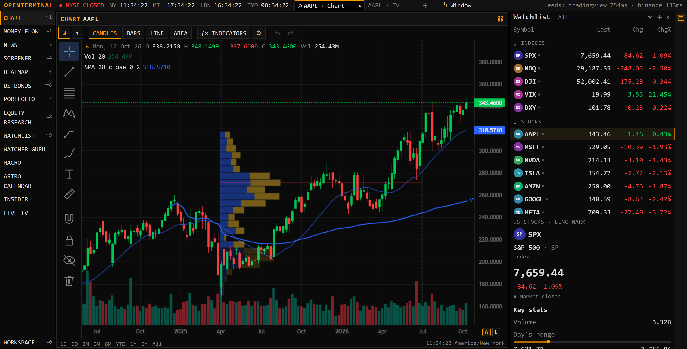

### Watchlist: every market in one dropdown

Every ranked coin with market cap, 24h volume and BTC/ETH dominance. The same dropdown lists stocks in 16 markets, ETFs, indices, futures and commodities.

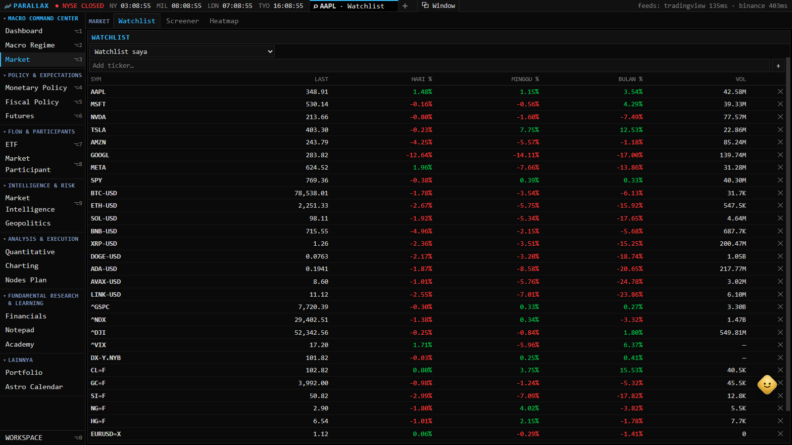

### Forex

172 pairs (major, minor, exotic) and the metals, live from TradingView's FX feed.

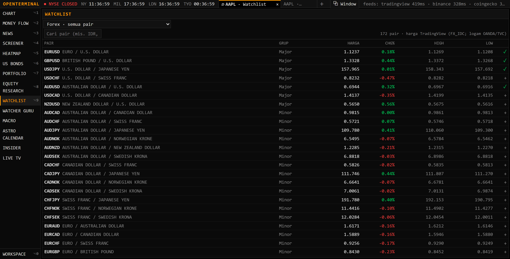

### Money Flow

What went into and out of an asset over a day, a week, a month, three months and a year, with every period's net and buy share.

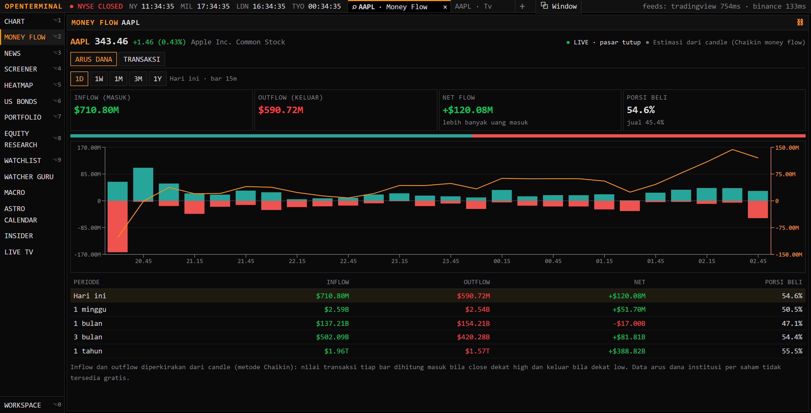

### Live sector heatmap

The whole US market as a treemap, sized by market cap and colored by the period's change.

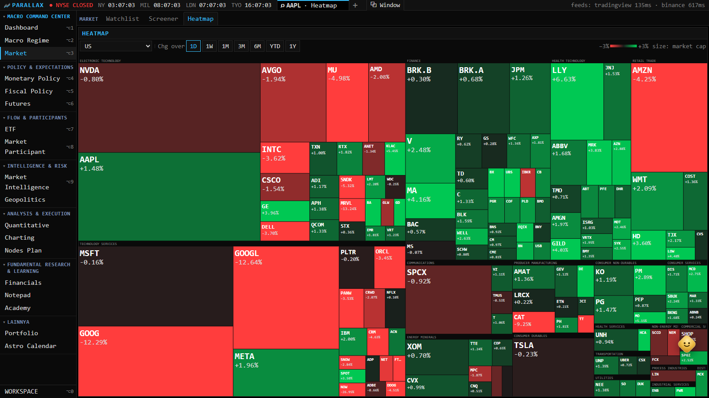

### Equity Research

Valuation, profitability and growth, Piotroski, Altman, Beneish and Graham, with statements, ratios, a DCF, analysts and peers on the other tabs.

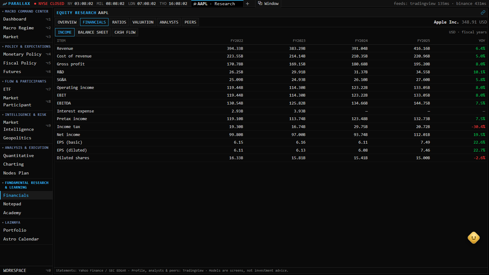

### News: the market recap

The day's recap beside the live wire: indexes, sector performance and the biggest movers, in English and Indonesian.

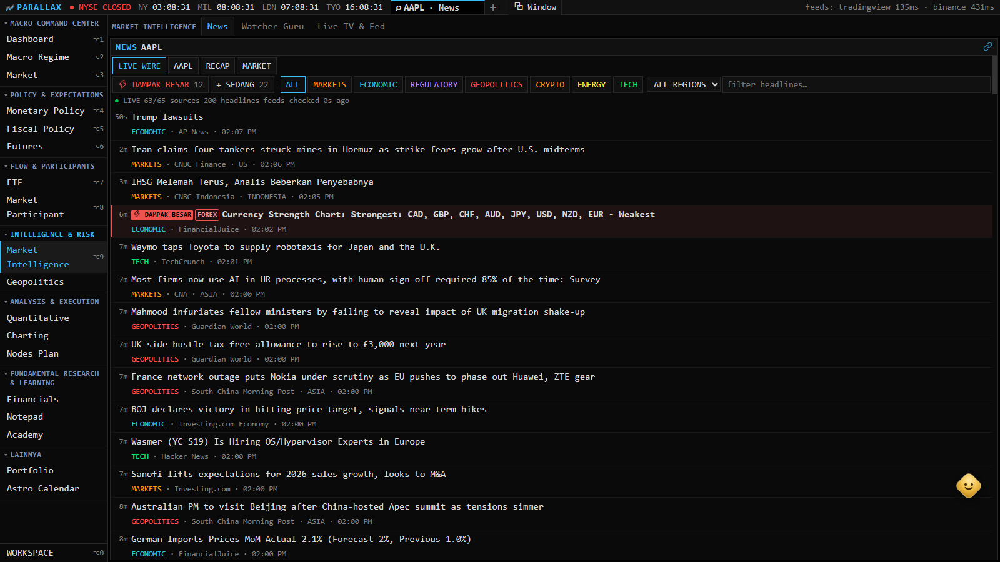

### Macro

The economic calendar by day with each release's history, flash headlines, FedWatch and the overnight funding rates.

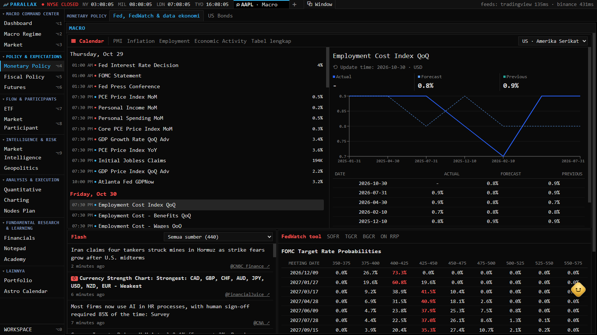

### Live TV and THE FED

Fed broadcasts play here as they go live (none at this moment), with the next high-impact US releases. On the right: the quant forecasts, each market's chance of a rise and its calendar-aware range, with no Bullish/Bearish where the record shows no edge.

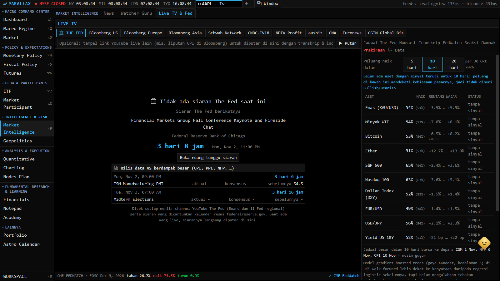

### Astro Calendar

The month's sky events, each with the quant forecast over its span and how it turned out.

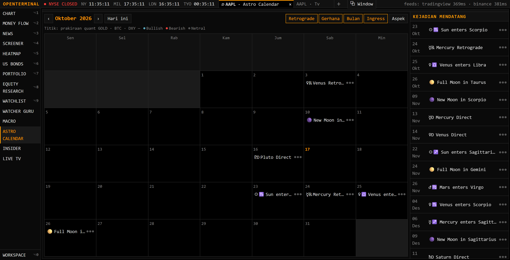

<br/>

## 🗂️ Data sources

No paid API and no keys. Every endpoint has a fallback chain, and results are cached with stale‑while‑revalidate (most also on disk), so an outage never blanks the UI.

| Data | Primary source | Fallback |
|---|---|---|
| Chart history (stocks, indices, FX, futures, coins) | TradingView chart feed (websocket) | Nasdaq → Yahoo Finance → Stooq; Binance → CoinGecko for coins |
| Quotes (US stocks/ETFs) | Nasdaq public quote API | Yahoo Finance → Stooq |
| Quotes (indices, non‑US stocks, FX, futures, metals) | TradingView scanner (one batched request) | Yahoo Finance |
| Market boards (stocks by market, ETFs, futures, forex), screener, heatmap | TradingView scanner | — |
| Fundamentals, profile, analysts, peers | TradingView scanner | — |
| Financial statements | Yahoo Finance fundamentals | SEC EDGAR XBRL company facts |
| Crypto board and candles | TradingView coin scanner · Binance market‑data mirror (`data-api.binance.vision`) | CoinGecko → Yahoo Finance |
| Live trades | Binance, Bybit, Bitget, Gate, HTX, BingX and Hyperliquid streams · TradingView quote stream for stocks | Bars |
| News | Many RSS feeds (Yahoo Finance, Google News, outlets' own) | — |
| Insider posts | Bluesky, Telegram public channels, Truth Social, X posts by link · SEC Form 4 | — |
| Treasury curve, auctions | FRED · TreasuryDirect | — |
| Economic calendar (actual, forecast, previous) | TradingView economic calendar | Forex Factory · FRED |
| FedWatch | Fed funds futures (CBOT ZQ) via TradingView | — |
| Nowcasts | Cleveland Fed inflation nowcast · Atlanta Fed GDPNow | — |
| Funding rates | New York Fed (SOFR, TGCR, BGCR, ON RRP) | — |
| Live TV | Broadcasters' own HLS streams · YouTube live captions | — |
| Sky positions | [`astronomy-engine`](https://github.com/cosinekitty/astronomy) (computed locally) | — |

> ⚠️ These are public endpoints, not licensed data feeds. Treat prices as delayed or indicative, not execution‑grade. Each provider is a small module in [`server/src/providers/`](server/src/providers), so swapping or adding one is quick.

<br/>

## 🚀 Quick start

```bash
git clone https://github.com/ihsanmp/Open-Terminal.git
cd Open-Terminal
npm install
npm run dev
```

- Web UI → **http://localhost:3000**
- API health → **http://localhost:4000/api/status**

No `.env` file is needed for a working terminal.

### Windows desktop app

```bash
desktop\install.cmd
```

This builds the project and adds an **OpenTerminal** shortcut to your Desktop and Start Menu.

- **Opening it** starts the API and web servers in the background and shows the terminal in its own window (Microsoft Edge or Chrome app mode). Closing that window stops the servers.
- **On every launch** it checks GitHub. If `origin/main` has new commits, it fast‑forwards, reinstalls dependencies when `package.json` changed, and rebuilds whatever changed before starting. Without network access, or with local edits in the way, it simply opens the current version.
- **Logs** go to `data/logs/`. `desktop\uninstall.ps1` removes the shortcuts.

### Macro engine from the terminal

```bash
npm run engine -- --mode backtest                  # walk-forward record of every target
npm run engine -- --mode live --target ppi_mom --consensus 0.5 --fed_sentiment 0.8
npm run engine -- --mode live --set gas=7.3        # override an input
npm run engine -- --mode train                     # fit and save the models (data/macro-engine/models.json)
npm run engine -- --mode reactions                 # how markets moved on the surprises
```

Build first (`npm run build`). The Fed watcher's voice and face layers need `ffmpeg` on the PATH (or `FFMPEG_PATH`). The panel's *Reguler* mode turns them off.

### Optional: AI assistant

```bash
export ANTHROPIC_API_KEY=sk-ant-...
npm run dev
```

Without a key, everything else still works. The AI widget just says it's unavailable.

### Security defaults

- **Local only by default.** The API binds to `127.0.0.1` and only accepts browser requests from `http://localhost:3000`.
- **Shared secret.** The portfolio, workspace, insider and AI endpoints require one. If you don't set `API_KEY`, the API generates a key on first run and saves it to `data/.api-key`. The bundled web app reads that file, so local dev stays zero‑config.
- **Exposing it beyond your machine.** Set `API_HOST=0.0.0.0`, `API_KEY=<a-strong-secret>` (on both the api and web processes) and `WEB_ORIGIN=<your origin>`, and keep dependencies patched.
- **AI rate limit.** `/api/ai` allows 10 requests per minute, keyed on `req.ip`. Behind the bundled web proxy, every caller shares one bucket. Set `TRUST_PROXY=1` **only if** your own reverse proxy in front sets `X-Forwarded-For` from the real client and doesn't let visitors set it themselves.

<br/>

## 🐳 Docker

```bash
docker compose up --build
```

Data persists in the `terminal-data` volume (SQLite, WAL mode). Ports are published on `127.0.0.1` only. See [Security defaults](#security-defaults) to expose them deliberately.

<br/>

## 🧱 Tech stack

| Layer | Stack |
|---|---|
| Frontend | Next.js 15 · React 19 · TypeScript · Tailwind CSS 4 · Zustand · TanStack Query |
| Charts | `lightweight-charts` · D3 (heatmap) · Recharts |
| Video | `hls.js` (live TV) · `@vladmandic/face-api` (Fed watcher's face layer) |
| Backend | Node.js · Express · TypeScript · Zod |
| Database | SQLite (`better-sqlite3`, WAL mode) plus JSON stores on disk |
| Sky | `astronomy-engine` |
| AI | Anthropic Claude (optional) |

<br/>

## 📁 Project structure

```
├── server/src/
│   ├── providers/      # one module per data source: tradingview, tvchart, nasdaq, yahoo, fred, binance,
│   │                   # socialfeed, moneyflow, transfers, macroengine, nowcast, fedwatch, fedtranscript…
│   ├── quant/          # the quant forecaster: data, features (market, macro, season), model, bands
│   ├── astro/          # the sky's events (kept identical to the web's by a test)
│   ├── news/           # news ingestion and the recap
│   ├── routes/         # market, research, portfolio, workspace, social, ai
│   ├── cli/            # the macro engine's command line
│   ├── cache.ts        # TTL cache with stale-while-revalidate and a disk fallback
│   └── db.ts           # SQLite (better-sqlite3, WAL)
├── web/
│   ├── components/widgets/  # every page: Chart, Watchlist, Money Flow, News, Insider, Macro, Live TV…
│   ├── components/chart/    # chart toolbars, drawing tools, indicator dialogs
│   ├── lib/ta/              # indicator engine: Pine-style ta.* core and the catalog
│   ├── lib/drawings/        # drawing tools
│   └── store/               # Zustand store (workspace, persisted with migrations)
└── desktop/            # Windows launcher, installer and auto-update
```

Run the tests with `npm test` (Vitest, no network calls, 1,000+ tests). The indicator suite compares values against a fixture captured from TradingView on the same candles, so a formula that drifts fails CI ([`.github/workflows/ci.yml`](.github/workflows/ci.yml)).

<br/>

## 🗺️ Roadmap

- [x] Chart drawing tools
- [x] Windows notifications: a Fed broadcast going live, the half hour before a release, a release's result and its first five minutes
- [ ] Release and Fed‑broadcast markers on the price chart
- [ ] Speech‑to‑text fallback for streams without captions
- [ ] PostgreSQL as an alternative to SQLite

Have an idea? [Open an issue](../../issues).

<br/>

## 🙏 Acknowledgements

- **Original project.** OpenTerminal was started by [Andrea Tasselli](https://github.com/ErTasselli/OpenTerminal); this fork builds on that first version.
- **Inspiration.** The equity‑research, world‑indices and all‑crypto features were inspired by [FinceptTerminal](https://github.com/Fincept-Corporation/FinceptTerminal). No code was taken from it: it is AGPL‑3.0 and this project is MIT, so the features were reimplemented independently on free data.
- **Indicators.** The indicators rebuilt from [LuxAlgo](https://www.luxalgo.com/)'s published scripts (in `web/lib/ta/indicators/luxalgo*.ts`) keep those scripts' license, CC BY‑NC‑SA 4.0: free to use and adapt, not for commercial use.

## 🤝 Contributing

Pull requests are welcome, especially:

- new or more resilient data providers (`server/src/providers/`);
- new widgets (`web/components/widgets/`);
- bug fixes and UI polish.

Please open an issue first for anything non‑trivial.

<br/>

## Known limitations

- **`npm audit` advisories.** Two remain, both inside Next.js and resolved only by the Next 16 major upgrade: `postcss` (high) and Next's own cache poisoning of SSG/ISR pages (moderate), which this app, rendered on demand on your machine, doesn't use.
- **Reverse proxies.** Behind a reverse proxy or load balancer, set `API_HOST`/`WEB_ORIGIN` to match and terminate TLS in front: the project doesn't handle HTTPS itself.
- **Blocked providers.** Some providers are blocked by some ISPs (Binance's main API, for one). The fallbacks cover them, sometimes with less detail.

<br/>

## ⚖️ Disclaimer

For personal and educational use only. Market data comes from public endpoints and may be delayed, incomplete or wrong, and the forecasts above have no tested edge. **Do not use this for real investment decisions.**

This project is not affiliated with, endorsed by or sponsored by any of the data providers it connects to. It doesn't host or redistribute data: it's source code you run yourself, fetching data directly from each provider. Respect their terms of service; most free sources are licensed for personal or research use only.

## License

[MIT](LICENSE), except the LuxAlgo‑derived indicators noted above (CC BY‑NC‑SA 4.0).
