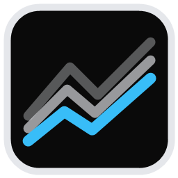
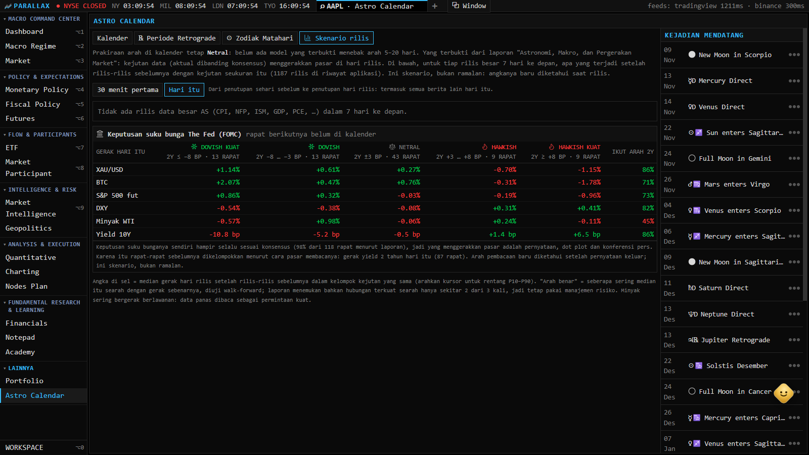
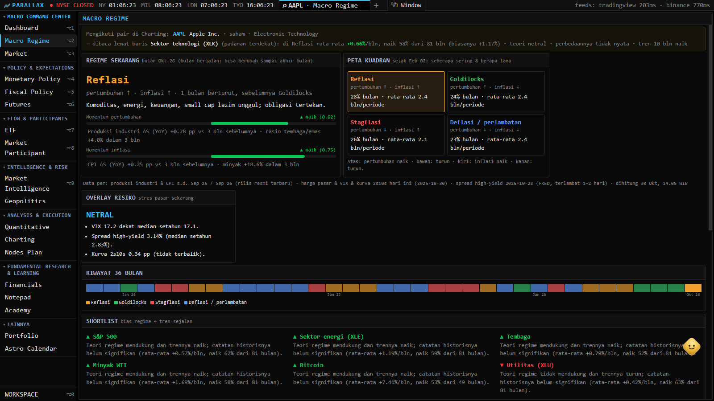
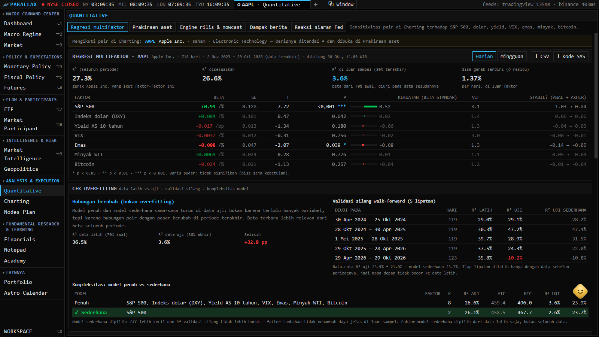
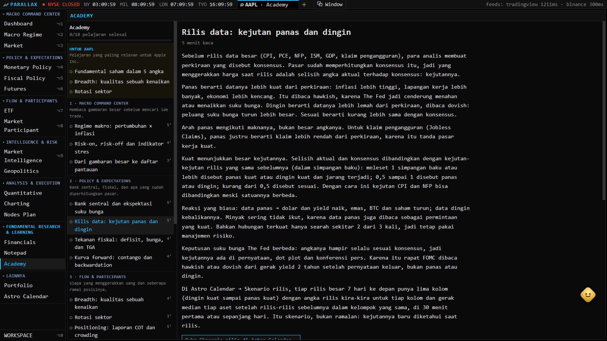

<div align="center">



# Parallax

**One market, many angles.** A terminal for reading markets the way they move: the macro calendar and the Fed, money flow and positioning, on‑chain whales and the chart, side by side.

Free, public data only. No API keys, no subscriptions. Runs on your machine.

[](#-tech-stack)
[](#license)
[](#%EF%B8%8F-data-sources)
[](#-project-structure)

<br/>


</div>

<br/>

## Why Parallax?

*Parallax* is how an object seems to shift when you look at it from another angle. Markets are like that: the same move reads differently through the macro calendar, the Fed's words, who is positioned where, and the chart. Parallax puts those angles in one keyboard‑first workspace.

It stitches together free, public market‑data endpoints into a fast terminal that runs entirely on your machine. Every endpoint has a fallback chain, so one provider's hiccup never blanks the app. Clone it, `npm install`, and you have a live terminal in a minute.

The models are honest. Wherever a forecast has no tested edge, the app says so instead of painting Bullish/Bearish. See [what the models are worth](#-what-the-models-are-worth).

<br/>

## ✨ Highlights

- **🏛️ The Fed, live.** Fed broadcasts play the moment they go live, with a running transcript, a hawkish/dovish **Fed Sentiment Index** read from the words, the voice and the face, and numbers fact‑checked as they're spoken.
- **📊 Release scenarios.** For each big US release of the coming week (CPI, PCE, NFP, ISM, GDP…), the app shows what gold, bitcoin, the S&P, the dollar and yields did after past prints that were hot, cold or in line, over the first 30 minutes and over the day.
- **🏦 FOMC scenarios.** The rate decision itself is almost always as expected, so past meetings are sorted by how the market read them, through the 2‑year yield (dovish to hawkish). Shown with FedWatch odds for the next meeting.
- **🔔 Windows notifications.** A reminder about three hours before a big release, with its scenarios. Then H‑30, the print against the consensus, and the first five minutes of the market's reaction. Raised by the server even with the window closed.
- **🗃️ A dataset that keeps itself.** Every release and Fed event is saved as CSV, watched or not: actuals, surprises, market reactions, live transcripts and official texts. Anything the app missed is filled from official sources by a scheduled Claude search.
- **🧭 Macro desk.** Growth × inflation regime with measured asset biases since 2002, a regime shortlist, fiscal stress, forward curves, COT positioning, ETF rotation and geopolitics.
- **📈 Charting.** TradingView depth of history, **167 indicators** (TradingView built‑ins ported from Pine's `ta.*` semantics plus 40+ community scripts) and 78 drawing tools.
- **🔭 Astro Calendar and assistant.** Sky events with the quant forecast over each span. A floating assistant answers from the app's own data, offline or through your Claude account, and can talk in conversation mode.
- **🎓 Academy.** Short lessons for every part of the menu, each ending with a place to practise and a quiz.

<br/>

## 📸 Tour

<table>
  <tr>
    <td width="50%"><br/><b>Charting</b>: any interval, 167 indicators, 78 drawing tools.</td>
    <td width="50%"><br/><b>Live TV and the Fed</b>: broadcasts, transcript, sentiment, forecasts.</td>
  </tr>
  <tr>
    <td><br/><b>Release and FOMC scenarios</b>: what markets did after each kind of surprise.</td>
    <td><br/><b>Macro regime</b>: the quadrant, its history and the shortlist.</td>
  </tr>
  <tr>
    <td><br/><b>Quantitative</b>: factor regression, forecasts, release engine, news impact.</td>
    <td><br/><b>Monetary policy</b>: calendar with history, flash wire, FedWatch.</td>
  </tr>
  <tr>
    <td><br/><b>Money flow</b>: what went in and out, from a day to a year.</td>
    <td><br/><b>Heatmap</b>: the whole US market, sized by market cap.</td>
  </tr>
  <tr>
    <td><br/><b>News</b>: 60+ sources de‑duplicated, with market‑moving headlines flagged.</td>
    <td><br/><b>Equity research</b>: statements, ratios, DCF, analysts, peers.</td>
  </tr>
  <tr>
    <td><br/><b>Watchlist</b>: day, week and month change side by side.</td>
    <td><br/><b>Astro Calendar</b>: retrogrades, eclipses, phases, ingresses.</td>
  </tr>
  <tr>
    <td><br/><b>Academy</b>: lessons and quizzes, from regimes to release surprises.</td>
    <td></td>
  </tr>
</table>

<br/>

## 🧩 Features

Pages sit in the sidebar by group. Any page can also be opened as a widget, dragged, resized and stacked in a saved workspace, or opened in its own window.

<details open>
<summary><b>Macro command center</b></summary>

- **Dashboard:** the big picture before a trade idea: regime and risk overlay, main markets over a day, week and month, the regime shortlist, three days of high‑impact releases, S&P 500 breadth, crowded COT positions and the hottest geopolitical theme.
- **Macro regime:** growth × inflation now, its 36‑month history, and each asset's average next‑month return per regime since 2002, called a bias only when it's statistically real.
- **Market:** watchlist (every stock in 16 markets, ETFs, world indices, futures, all ranked coins, 170+ FX pairs), screener and heatmap.

</details>

<details>
<summary><b>Policy and expectations</b></summary>

- **Monetary policy:** the economic calendar by day with two years of each release's actuals against forecasts, a flash headline wire, FedWatch odds from fed funds futures, overnight funding rates (SOFR, TGCR, BGCR, ON RRP), and the US Treasury curve with each benchmark's coupon, maturity and next auction.
- **Fiscal policy:** debt, monthly deficits, interest burden and the Treasury General Account.
- **Futures:** forward curves, implied carry and the rate path priced by SOFR and fed funds futures.

</details>

<details>
<summary><b>Flow and participants</b></summary>

- **ETF:** themes, relative performance against SPY, sector rotation, breadth, and US spot crypto ETF flows.
- **Positioning (COT):** speculators, large holders and hedgers in 25 futures markets, with a 3‑year COT index.
- **Money flow:** inflow and outflow over a day to a year. Coins on Binance use real trades; everything else is estimated from bars. The transfers tab shows who moved what: named Bitcoin wallets, big exchange trades, watched Ethereum wallets, ETF flows, treasury companies' filings and US insiders.
- **Insider:** what market‑moving accounts post first (Bluesky, Telegram, Truth Social, X by link), each with how its identity was verified and whether news outlets have reported it since; plus SEC Form 4 insider trades. Whale and institution pop‑ups follow the pair on screen.

</details>

<details>
<summary><b>Intelligence and risk</b></summary>

- **News:** a live wire de‑duplicated across 60+ sources, by category, region and symbol, with a daily or weekly recap. Headlines likely to move markets are tagged with the markets they hit.
- **Live TV and the Fed:** ten business channels as HLS, any YouTube live link, and **THE FED**:
  - **Broadcasts** as they go live, counted down from the Board's own calendar.
  - **Transcript** from live captions and the **Fed Sentiment Index** in three layers: the words, the main speaker's voice (pitch, pauses, fillers; voices told apart) and their face (locked by lip sync). Figures said about the economy are fact‑checked against first‑published releases, FRED and an offline record of every FOMC decision since 1982. Events said are looked up in the app's own news archive.
  - **Nowcast** (Cleveland Fed inflation, GDPNow) beside the app's own P10/P50/P90 for the next CPI, PPI, payrolls, PCE, retail sales, GDP, claims and ISM.
  - **Reactions and impact:** how markets moved on each release and broadcast.
  - **Notifications** and **Data** (below).
- **Geopolitics:** themes heating up against their usual week, escalation versus easing, safe‑haven gauges and a 7‑day risk calendar.

</details>

<details>
<summary><b>Analysis and execution</b></summary>

- **Quantitative:**
  - **Multifactor regression** of the pair on screen against the S&P 500, the dollar, yields, VIX, gold, oil and bitcoin. Newey‑West errors, walk‑forward validation, robust transformations (winsorised, Huber, WLS) and rolling betas, with exports to CSV and SAS.
  - **Asset forecasts.**
  - **The release engine and nowcasts.**
  - **News impact.**
  - **Fed‑broadcast reactions.**
- **Charting:** candles, bars, line and area at any interval, with as much history as TradingView holds. 167 indicators with their own settings, panes, fills and a TradingView‑style legend. The core built‑ins are checked value for value against TradingView's own numbers in the test suite. 78 drawing tools (channels, pitchforks, Fib and Gann, harmonics, Elliott, positions, anchored VWAP, fixed‑range volume profile…). Cross pairs such as SOL‑BTC, and currency conversion.
- **Nodes plan:** a thesis turned into six nodes (thesis, context and catalysts, trigger, execution with R:R, risk and position size, review), compared live with the price.

</details>

<details>
<summary><b>Research and learning</b></summary>

- **Financials:** multi‑year statements, ratios with DuPont, Piotroski F, Altman Z, Beneish M, the Graham number, an interactive DCF, analyst consensus and peers.
- **Notepad:** a research journal with symbols, tags, templates and links to trade plans.
- **Academy:** lessons following the menu, each with a place to practise and a quiz.
- **Portfolio:** a trading journal with notes and emotions before and after, chart images, average cost, realised and unrealised P&L, and Excel import and export.

</details>

<details>
<summary><b>Astro Calendar and the assistant</b></summary>

- **Astro Calendar:**
  - The month's sky events (retrogrades, eclipses, phases, ingresses, aspects), each with the quant forecast for gold, bitcoin and the dollar over its span and how it turned out.
  - Each planet's retrograde periods to the minute, and the Sun's ingresses.
  - **Release scenarios** and **FOMC scenarios** (above).
- **Assistant:** a floating bubble on every page that answers from the app's own data: the next retrograde or eclipse, a date's close, a span's performance, drawdowns, seasonality, correlations, the forecasts, how to read any page, and ~30 topics of price action, macro and financial astrology.
  - **Claude mode** reads the data the app gathered (markets, forecasts, news) through the Claude Code CLI signed in with your own Claude account. It can see the app's window when asked and answer by voice.
  - **Conversation mode** listens and replies hands‑free in English or Indonesian. Optionally it uses ElevenLabs for speech and transcription.
  - **Offline mode** answers with the app's own calculations.
- **AI Assist** (optional): ask Claude about the symbol on screen, with the terminal's data as context.

</details>

<details>
<summary><b>Notifications and the news dataset</b></summary>

- **Notifications** (native Windows toasts, each kind switchable):
  - a Fed broadcast going live;
  - about three hours before a big release: its consensus and the scenarios, or for the Fed's decision, the dovish and hawkish cases;
  - H‑30 with the engine's band and the bias;
  - the print against the consensus;
  - the first five minutes of gold, bitcoin, the S&P, the dollar and the 2‑year yield.
- **News dataset** in `data/newsdata/`, refreshed every 30 minutes while the app runs and committed to this repository daily:

  | File | What's in it |
  |---|---|
  | `releases.csv` | Every big US release since 2016: actual, consensus, previous, surprise, its side, the engine's call |
  | `reactions.csv` | Each market's first 30 minutes and day after each release and Fed event |
  | `fed_events.csv` | Each Fed event of the last 45 days: minutes heard live, the official text, both read hawkish/dovish |
  | `gaps.csv` | What's still missing |
  | `texts/` | Live transcripts and official texts (statements, press‑conference transcripts, speeches, minutes) |

  The app fetches official Fed texts itself. A scheduled Claude task fills only what it couldn't find, from official sources and with the source recorded. Its data never overwrites the app's own.

</details>

<br/>

## 📏 What the models are worth

- **Direction.** A gradient‑boosted forecaster (depth 3, walk‑forward from 2016) gives each market's chance of a rise over 5, 10 and 20 days. No market or horizon beats the plain bet on its usual side, so no Bullish/Bearish is shown. A side would be called only when the record beats that bet (z ≥ 1.64 and Brier skill > 0).
- **Ranges.** Calendar‑aware P10–P90 ranges are better calibrated than plain ones in 27 of 30 market‑horizons.
- **Releases.** The engine roughly matches the consensus for most releases; only GDPNow clearly beats it on GDP. Surprises do move markets on the day, but even the strongest link goes the expected way only about 2 times in 3.
- **Fed Sentiment Index.** Calibrated on 71 FOMC press conferences (2016–2026). It runs with the rate decision (r 0.52) and the 2‑year yield's next three months (r 0.38). It doesn't foretell the day's move, which is already priced.
- **Astrology.** The astro event study is right about as often as a coin. Only the season is kept, and it adds nothing reliable yet.

Read them as context, not as trading signals.

<br/>

## 🚀 Quick start

```bash
git clone https://github.com/ihsanmp/Parallax.git
cd Parallax
npm install
npm run dev
```

- Web UI → **http://localhost:3000**
- API health → **http://localhost:4000/api/status**

No `.env` file is needed for a working terminal.

### Windows desktop app

```bash
desktop\install.cmd
```

This builds the project and adds a **Parallax** shortcut to your Desktop and Start Menu.

- **Opening it** starts the servers in the background and shows the terminal in its own window (Edge or Chrome app mode). Closing the window stops them.
- **On every launch** it checks GitHub, fast‑forwards to new commits, reinstalls dependencies when needed and rebuilds what changed. Offline, it simply opens the current version.
- **Logs** go to `data/logs/`. `desktop\uninstall.ps1` removes the shortcuts.

### Optional extras

| Feature | Needs |
|---|---|
| Claude mode of the assistant | [Claude Code](https://claude.com/claude-code) signed in with your Claude account (no API key) |
| AI Assist widget | `ANTHROPIC_API_KEY` |
| Fed watcher's voice and face layers | `ffmpeg` on the PATH (or `FFMPEG_PATH`) |
| Natural voice and transcription | An ElevenLabs key in `data/.elevenlabs-key` |
| Official Fed press‑conference transcripts | `pdftotext` (ships with Git for Windows) |

Without them, everything else works.

### Macro engine from the terminal

```bash
npm run engine -- --mode backtest                  # walk-forward record of every target
npm run engine -- --mode live --target ppi_mom --consensus 0.5 --fed_sentiment 0.8
npm run engine -- --mode train                     # fit and save the models
npm run engine -- --mode reactions                 # how markets moved on the surprises
```

Build first (`npm run build`).

### Security defaults

- **Local only.** The API binds to `127.0.0.1` and only accepts the web app's origin.
- **Shared secret.** Portfolio, workspace, insider and AI endpoints require one. Without `API_KEY`, one is generated on first run in `data/.api-key` and read by the bundled web app.
- **Exposing it.** Set `API_HOST=0.0.0.0`, a strong `API_KEY` on both processes and `WEB_ORIGIN`, terminate TLS in front, and keep dependencies patched. Set `TRUST_PROXY=1` only behind your own proxy that sets `X-Forwarded-For`.

### 🐳 Docker

```bash
docker compose up --build
```

Data persists in the `terminal-data` volume. Ports are published on `127.0.0.1` only.

<br/>

## 🗂️ Data sources

No paid API and no keys. Every endpoint has a fallback chain, and results are cached with stale‑while‑revalidate (most also on disk), so an outage never blanks the UI.

| Data | Primary source | Fallback |
|---|---|---|
| Chart history | TradingView chart feed | Nasdaq → Yahoo Finance → Stooq; Binance → CoinGecko |
| Quotes | Nasdaq · TradingView scanner | Yahoo Finance → Stooq |
| Boards, screener, heatmap, fundamentals | TradingView scanner | — |
| Financial statements | Yahoo Finance | SEC EDGAR XBRL |
| Crypto and live trades | TradingView coin scanner · Binance, Bybit, Bitget, Gate, HTX, BingX, Hyperliquid | CoinGecko → Yahoo Finance |
| On‑chain | Public Bitcoin and Ethereum explorers · address labels | — |
| News | RSS from 60+ outlets | — |
| Insider posts and trades | Bluesky, Telegram, Truth Social, X by link · SEC Form 4 | — |
| Economic calendar | TradingView economic calendar | Forex Factory · FRED |
| Fed texts and schedule | federalreserve.gov (calendar, statements, transcripts, speeches, minutes) | — |
| FedWatch · nowcasts · funding | Fed funds futures · Cleveland Fed, GDPNow · New York Fed | — |
| Treasuries · fiscal · COT | FRED, TreasuryDirect · Fiscal Data API · CFTC | — |
| Live TV | Broadcasters' HLS streams · YouTube live captions | — |
| Sky positions | [`astronomy-engine`](https://github.com/cosinekitty/astronomy) (local) | — |

> ⚠️ Public endpoints, not licensed feeds: treat prices as delayed or indicative. Each provider is a small module in [`server/src/providers/`](server/src/providers).

<br/>

## 🧱 Tech stack

| Layer | Stack |
|---|---|
| Frontend | Next.js 15 · React 19 · TypeScript · Tailwind CSS 4 · Zustand · TanStack Query |
| Charts | `lightweight-charts` · D3 · Recharts |
| Video and voice | `hls.js` · `@vladmandic/face-api` · Web Speech · ElevenLabs (optional) |
| Backend | Node.js · Express · TypeScript · Zod |
| Storage | SQLite (`better-sqlite3`, WAL) · JSON and CSV on disk |
| AI | Claude, through Claude Code or the API (optional) |

## 📁 Project structure

```
├── server/src/
│   ├── providers/   # one module per data source and engine (tvchart, macroengine, fedtranscript, newsimpact…)
│   ├── quant/       # the quant forecaster
│   ├── newsdata/    # the CSV news dataset and its inbox
│   ├── notify/      # Windows notifications
│   ├── astrochat/   # the assistant (Claude mode, voice)
│   └── routes/      # the HTTP API
├── web/
│   ├── components/  # pages, widgets, chart toolbars
│   ├── lib/ta/      # indicator engine: Pine-style ta.* core and the catalog
│   └── store/       # workspace state
├── scripts/         # build, and the news dataset's helpers
├── data/newsdata/   # the news dataset (committed)
└── desktop/         # Windows launcher, installer, icon
```

`npm test` runs 1,300+ tests (Vitest, no network). The indicator suite compares values against a fixture captured from TradingView on the same candles.

<br/>

## 🙏 Acknowledgements

- **Where it began.** Parallax grew out of [OpenTerminal](https://github.com/ErTasselli/OpenTerminal) by Andrea Tasselli, released under the MIT license. The original copyright notice is kept in [LICENSE](LICENSE).
- **Inspiration.** The equity‑research, world‑indices and all‑crypto features were inspired by [FinceptTerminal](https://github.com/Fincept-Corporation/FinceptTerminal). No code was taken from it (it's AGPL‑3.0); the features were reimplemented independently.
- **Indicators.** Community scripts are ported under their own licenses: the MPL‑2.0 ones in `web/lib/ta/indicators/community2.ts`, and the [LuxAlgo](https://www.luxalgo.com/) ones in `luxalgo*.ts` under CC BY‑NC‑SA 4.0 (not for commercial use).

## ⚖️ Disclaimer

For personal and educational use only. Data comes from public endpoints and may be delayed, incomplete or wrong, and the forecasts have no tested edge. **Do not use this for real investment decisions.** This project isn't affiliated with any data provider and doesn't host or redistribute data: it's code you run yourself, fetching from each provider directly. Respect their terms of service.

## License

[MIT](LICENSE), except the indicators ported under their own licenses (above).
